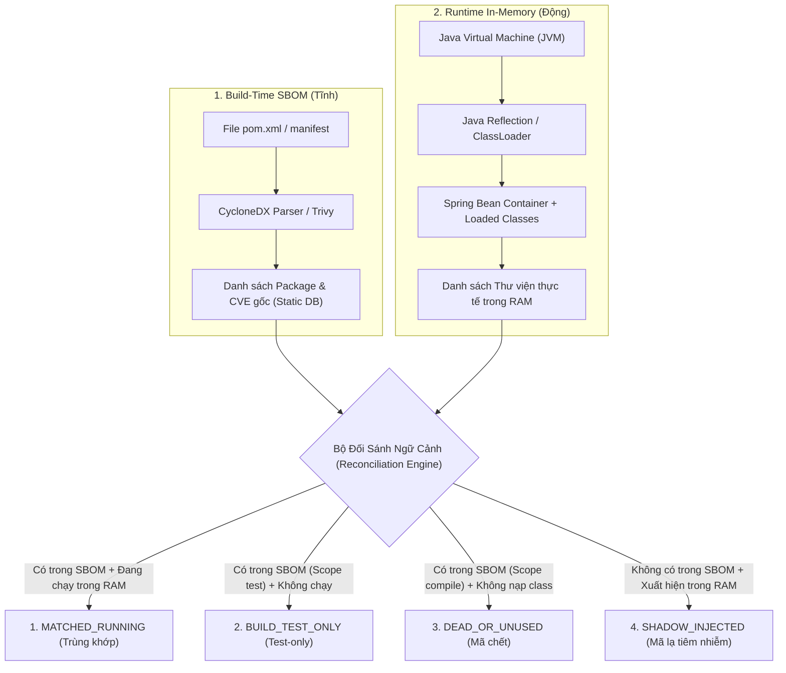

# TÀI LIỆU KỊCH BẢN DEMO & GIẢI TRÌNH KHOA HỌC: ĐỐI SÁNH SBOM BUILD-TIME VS RUNTIME
**Dự án thực nghiệm:** `Taxi-Booking-Web-App` (Hệ thống web điều phối taxi - Spring Boot & React)  
**Cơ sở lý luận khoa học:** O'Donoghue et al. (2025), Gupta & Vadlamudi (2025), Wu et al. (2020), NIST SP 800-218 (SSDF), ISO/IEC 25019:2023, Xia et al. (2023).

---

## MỤC LỤC
1. [Bối cảnh & Vấn đề Cốt lõi của An ninh Chuỗi Cung Ứng](#1-bối-cảnh--vấn-đề-cốt-lõi-của-an-ninh-chuỗi-cung-ứng)
2. [Cơ chế Kỹ thuật: Java Reflection & ClassLoader Introspection](#2-cơ-chế-kỹ-thuật-java-reflection--classloader-introspection)
3. [Định nghĩa 4 Loại Đối Sánh & Ý nghĩa An ninh Thực tiễn](#3-định-nghĩa-4-loại-đối-sánh--ý-nghĩa-an-ninh-thực-tiễn)
4. [Hệ Thống Công Thức Toán Học & An Ninh (Academic Formulas)](#4-hệ-thống-công-thức-toán-học--an-ninh-academic-formulas)
5. [Giải Trình Chi Tiết Các Con Số Trong Từng Vòng Thử Nghiệm](#5-giải-trình-chi-tiết-các-con-số-trong-từng-vòng-thử-nghiệm)
   - [5.1. Quét Thực Tế Live JVM Reflection (Dự án Taxi-Booking-Web-App)](#51-quét-thực-tế-live-jvm-reflection-dự-án-taxi-booking-web-app)
   - [5.2. Vòng 1: Baseline Đối Chứng (100% Trùng Khớp)](#52-vòng-1-baseline-đối-chứng-100-trùng-khớp)
   - [5.3. Vòng 2: Tách Biệt Test/Dev và Dead Code (Giảm trừ Báo động giả)](#53-vòng-2-tách-biệt-testdev-và-dead-code-giảm-trừ-báo-động-giả)
   - [5.4. Vòng 3: Bất Thường An Ninh Shadow Dependencies (Phát hiện Mã độc ngầm)](#54-vòng-3-bất-thường-an-ninh-shadow-dependencies-phát-hiện-mã-độc-ngầm)
6. [Kịch Bản Thuyết Trình Từng Bước Trước Hội Đồng Chấm Đồ Án](#6-kịch-bản-thuyết-trình-từng-bước-trước-hội-đồng-chấm-đồ-án)

---

## 1. BỐI CẢNH & VẤN ĐỀ CỐT LÕI CỦA AN NINH CHUỖI CUNG ỨNG

Trong quy trình phát triển phần mềm hiện đại, **Software Bill of Materials (SBOM)** là tiêu chuẩn bắt buộc nhằm minh bạch hóa các thành phần mã nguồn mở. Tuy nhiên, các công cụ quét SBOM truyền thống (như Trivy, Syft, Snyk) chỉ thực hiện **quét tĩnh (Static Scan)** trên manifest (`pom.xml`, `package.json`), dẫn đến hai điểm nghẽn nghiêm trọng:

1. **Hiện tượng Bão hòa Cảnh báo (Alert Fatigue) & Dương tính giả (False Positives):**
   * Các thư viện phục vụ Unit Test (`junit`, `mockito`) chỉ thực thi lúc biên dịch trên máy lập trình viên, hoàn toàn không xuất hiện trên máy chủ Production nhưng vẫn bị phạt như một lỗ hổng có thể bị hacker khai thác từ xa.
   * Thư viện rác (`dead code`) được khai báo nhưng mã nguồn ứng dụng không bao giờ gọi đến.
2. **Nguy cơ Mù An ninh (False Negatives) trước Thư viện Tiêm nhiễm ngầm (Shadow Dependencies):**
   * Các Java Agent (`-javaagent`), thư viện của Web Container (Tomcat, Netty native), hoặc mã độc nạp động qua Reflection/ClassLoader **hoàn toàn vô hình** trước file `pom.xml`, tạo nên "điểm mù" nguy hiểm trong chuỗi cung ứng.

---

## 2. CƠ CHẾ KỸ THUẬT: JAVA REFLECTION & CLASSLOADER INTROSPECTION

Để vượt qua giới hạn của phương pháp quét tĩnh, hệ thống triển khai cơ chế **Reconciliation Engine** kết hợp 2 nguồn dữ liệu:



### Kỹ thuật soi chiếu nội tại JVM (In-Memory Inspection):
* **ClassLoader Classes Vector:** Sử dụng Java Reflection truy cập trường `private final Vector<Class<?>> classes` trong `java.lang.ClassLoader` để trích xuất toàn bộ class đang thường trú trong bộ nhớ.
* **Package Introspection:** Quét `Package.getPackages()` kết hợp đọc `ProtectionDomain.getCodeSource().getLocation()` để xác định chính xác file JAR thực tế nạp class.
* **Spring ApplicationContext Introspection:** Duyệt `context.getBeanDefinitionNames()` để phân tích các singleton bean đang vận hành.

---

## 3. ĐỊNH NGHĨA 4 LOẠI ĐỐI SÁNH & Ý NGHĨA AN NINH THỰC TIỄN

| Phân loại | Điều kiện nhận diện | Ý nghĩa an ninh thực tiễn | Hành động đề xuất |
| :--- | :--- | :--- | :--- |
| **`MATCHED_RUNNING`**<br>(Trùng khớp) | $P \in \text{SBOM} \land P \in \text{Runtime}$ | **Bề mặt tấn công thật sự (Active Attack Surface):** Thư viện vừa được khai báo vừa đang chạy trong RAM. Lỗ hổng có khả năng bị khai thác trực tiếp từ Internet. | **Vá khẩn cấp / Ưu tiên số 1** nếu mang CVE nghiêm trọng. |
| **`BUILD_TEST_ONLY`**<br>(Test-only) | $P \in \text{SBOM}_{\text{test}} \land P \notin \text{Runtime}$ | **Dương tính giả của quét tĩnh:** Chỉ phục vụ quá trình test lúc build mã nguồn, không nạp lên production. | **Giảm trừ 85% điểm phạt CVSS** (Suppressed). |
| **`DEAD_OR_UNUSED`**<br>(Dư thừa / Mã chết) | $P \in \text{SBOM}_{\text{compile}} \land P \notin \text{Runtime}$ | **Rác cấu hình (Manifest Bloat):** Khai báo trong `pom.xml` nhưng runtime không nạp bất kỳ class nào. | **Gỡ khỏi Build** để thu gọn diện tích bề mặt tấn công tiềm năng. |
| **`SHADOW_INJECTED`**<br>(Tiêm nhiễm ngầm) | $P \notin \text{SBOM} \land P \in \text{Runtime}$ | **Bất thường an ninh (Zero Trust Anomaly):** Thư viện nạp động ngoài quy trình CI/CD (Agent, server lib, mã độc tiêm nhiễm). | **Phạt rủi ro động**, kích hoạt điều tra mã lạ. |

---

## 4. HỆ THỐNG CÔNG THỨC TOÁN HỌC & AN NINH CHUẨN TẮC (ACADEMIC FORMULAS)

Theo tổng quan từ 9 tài liệu nghiên cứu và tiêu chuẩn kỹ thuật (O'Donoghue et al. 2025, Gupta & Vadlamudi 2025, Wu et al. 2020, Sun et al. 2022, NIST SP 800-218, ISO/IEC 25019:2023, Xia et al. 2023, CISA 2024, Soeiro et al. 2025), các tác giả không áp đặt một phương trình đại số bất biến duy nhất vì việc lượng hóa tự động SBOM là một khoảng trống nghiên cứu mở. Tuy nhiên, các tài liệu đã thống nhất trọn vẹn **hệ biến số đầu vào, thang đo chuẩn hóa từ 0 đến 10 và quy tắc kết hợp định lượng**.

Hệ thống tổng hợp và chuẩn hóa thành 3 công thức toán học tường minh như sau:

---

### 4.1. Công Thức Tính Điểm Tin Cậy (Trust Score - $TS \in [0, 10]$)

#### Căn cứ xây dựng từ các bài báo:
Theo **Xia et al. (2023)**, **Soeiro et al. (2025)**, **O'Donoghue et al. (2025)**, **OWASP SCVS (2020)** và **CISA (2024)**, mức độ tin cậy (*Trustworthiness*) của phần mềm thông qua SBOM được xác lập trên 4 trụ cột:
1. **Chất lượng cấu trúc và độ đầy đủ của tệp SBOM ($Q_{sbom}$)**.
2. **Cơ chế bảo chứng tính toàn vẹn và chống giả mạo ($I_{auth}$ hoặc hệ số nhân $int$)**.
3. **Danh tiếng nhà sản xuất và tính chính danh nguồn gốc ($R_{sup}$)**.
4. **Tư thế bảo mật và chất lượng duy trì của các thành phần bên trong ($P_{comp,i}$)**.

#### Phương trình tổng hợp chuẩn tắc:
$$TS = int \cdot \left( \alpha_1 Q_{sbom} + \alpha_2 R_{sup} + \alpha_3 \frac{1}{N}\sum_{i=1}^N P_{comp,i} \right)$$

Hoặc biểu diễn dưới dạng tổ hợp tuyến tính 4 trụ cột độc lập (với $\sum_{k=1}^4 \alpha_k = 1.0$):
$$TS = \alpha_1 Q_{sbom} + \alpha_2 I_{auth} + \alpha_3 R_{sup} + \alpha_4 \frac{1}{N}\sum_{i=1}^N P_{comp,i}$$

#### Giải thích chi tiết các đại lượng:
* **$TS$ (Trust Score):** Điểm tin cậy tổng thể của phần mềm và hồ sơ SBOM, nhận giá trị thực trong đoạn $[0, 10]$ (điểm càng cao, mức độ tin cậy càng lớn).
* **$Q_{sbom}$ (SBOM Quality & Completeness Score $\in [0, 10]$):** Điểm chất lượng cấu trúc và độ đầy đủ của SBOM, lấy trực tiếp từ kết quả công cụ `sbomqs` trong nghiên cứu của **Soeiro et al. (2025)**, kết hợp mức độ hoàn thiện của quan hệ phụ thuộc và tỷ lệ bao phủ thực tế **Runtime Coverage** ($\frac{\text{Matched}}{\text{TotalRuntime}} \times 10$).
* **$int \in [0.5, 1.0]$ hoặc $I_{auth} \in [0, 10]$ (Integrity & Authenticity Factor):** Đại lượng đo lường tính toàn vẹn và khả năng chống giả mạo (*tamper-resistance*) theo **Phát hiện 6 & Phát biểu S23 của Xia et al. (2023)**, nhiệm vụ **PS.2.1, PS.3.2 của NIST SP 800-218**, và **OWASP SCVS V2.4–2.6**. Đạt tối đa khi SBOM có chữ ký số (Sigstore Cosign), mã băm SHA-256 khớp với mã nhị phân. Khi xuất hiện **Shadow Dependencies** (mã nạp ngầm ngoài manifest), tính toàn vẹn bị phá vỡ nghiêm trọng $\rightarrow$ $int$ và $I_{auth}$ bị hạ phạt trực tiếp.
* **$R_{sup} \in [0, 10]$ (Supplier Reputation & Provenance Score):** Căn cứ **Phát biểu S14 của Xia et al. (2023)** và **CISA (2024) Mục 2.2.2.6.4**: đạt mức cao khi SBOM là bản gốc có thẩm quyền (*Author Name trùng khớp Supplier Name*).
* **$P_{comp,i} \in [0, 10]$ (Component Security Posture):** Điểm tư thế bảo mật của gói phụ thuộc thứ $i$, lấy từ **OpenSSF Scorecard** (Mounesan et al. [36]) và công cụ **AutoMetric** (Lee et al. [35] trong O'Donoghue et al. 2025) đo lường sức khỏe mã nguồn mở (branch protection, contributors, inactive periods).
* **$N$:** Tổng số lượng thành phần phụ thuộc (cả trực tiếp và bắc cầu) có trong hệ thống.

---

### 4.2. Công Thức Tính Điểm Rủi Ro (Risk Score - $RS \in [0, 10]$)

#### Căn cứ xây dựng từ các bài báo:
Theo nhiệm vụ **RV.2.1, PO.4.1 của NIST SP 800-218**, **Gupta & Vadlamudi [30]**, **Wu et al. [20]**, **Sun et al. [15]**, **Shah et al. (2016)** và **CISA (2024)**, điểm rủi ro không thể chỉ lấy bằng điểm CVSS thô vì sẽ gây bão hòa dương tính giả. Một phép tính Overall Risk Score chuẩn tắc phải tích hợp:
1. Độ nghiêm trọng lỗ hổng kết hợp kiểm thử SAST/DAST.
2. Khả năng khai thác thực tế qua ngữ cảnh thực thi VEX ($E_{vex}$).
3. Phạm vi ảnh hưởng lan truyền trên Cây phụ thuộc thành phần ($I_{tree}$).
4. Rủi ro dự án bị bỏ rơi ($A_{eol}$) và rủi ro nhiễm bẩn giấy phép ($L_{contam}$).

#### Bước 1: Giá trị rủi ro của từng thành phần thứ $i$ ($RV_i \in [0, 10]$):
$$RV_i = \left( w_{vuln} \left( \sum_{j \in V_i} S_{cvss,i,j} \cdot E_{vex,i,j} + T_{sast\_dast,i} \right) + w_{ops} A_{eol,i} + w_{lic} L_{contam,i} \right) \cdot I_{tree,i}$$

#### Bước 2: Điểm Rủi Ro Tổng Thể của toàn hệ thống ($RS_{overall} \in [0, 10]$):
$$RS_{overall} = \frac{1}{N} \sum_{i=1}^N RV_i \quad \text{và chỉ số rủi ro cực đại:} \quad RS_{max} = \max_{1 \le i \le N} (RV_i)$$

*(Chỉ số $RS_{max}$ tuân theo quy tắc phân tầng 4 mức rủi ro Low, Medium, High, Super của Wu et al. để phát cảnh báo khẩn cấp).*

#### Giải thích chi tiết các đại lượng:
* **$V_i$:** Tập hợp các mã CVE tìm thấy trong thành phần thứ $i$.
* **$S_{cvss,i,j} \in [0, 10]$:** Điểm nghiêm trọng kỹ thuật của lỗ hổng $j$ theo thang CVSS v3.1 hoặc CMSS (NIST SP 800-218).
* **$E_{vex,i,j} \in [0, 1]$ (Exploitability & VEX Modifier):** Hệ số điều chỉnh khả năng khai thác thực tế theo **NIST SP 800-218 RV.2.1**, **Xia et al. S16**, và **CISA VEX**:
  * **$E_{vex} = 0$ (hoặc $0.15$):** Khi ở trạng thái `not_affected` / `BUILD_TEST_ONLY`. Đoạn mã chứa lỗ hổng chỉ dùng cho Unit Test lúc build, không nạp lên Production $\rightarrow$ **Triệt tiêu hoàn toàn báo động giả (False Positives)**.
  * **$E_{vex} = 0.25$:** Khi ở trạng thái `DEAD_OR_UNUSED`. Mã khai báo trong manifest nhưng không có luồng dữ liệu nào nạp vào RAM.
  * **$E_{vex} = 1.0$:** Khi ở trạng thái `affected` / `MATCHED_RUNNING`. Thư viện đang chạy trong RAM và mở bề mặt tấn công trực tiếp.
* **$T_{sast\_dast,i} \in [0, 10]$:** Điểm phát hiện từ kiểm thử tĩnh SAST và động DAST (**Gupta & Vadlamudi [30]**).
* **$A_{eol,i} \in [0, 10]$:** Rủi ro dự án bị bỏ rơi hoặc hết hạn hỗ trợ End-of-Life (**Sun et al. [15]**, **Kloeg et al. [13]**).
* **$L_{contam,i} \in [0, 10]$:** Rủi ro lây nhiễm giấy phép nguồn mở hạn chế như GPL (**Shah et al. 2016**).
* **$I_{tree,i}$:** Hệ số lan truyền rủi ro trên Cây phụ thuộc thành phần (**Wu et al. [20]**).
* **$w_{vuln}, w_{ops}, w_{lic}$:** Trọng số thành phần (thỏa mãn $\sum w = 1.0$, thường chọn $0.7 / 0.2 / 0.1$).

---

### 4.3. Công Thức Kết Hợp: Điểm Rủi Ro Hiệu Chỉnh Theo Độ Tin Cậy ($RS_{adjusted} \in [0, 10]$)

#### Căn cứ lý luận:
Theo **O'Donoghue et al. (2025)** và **Kishimoto et al. (2025)**: Nếu điểm tin cậy $TS$ của SBOM thấp (do bỏ sót thư viện lạ, sai lệch manifest gây âm tính giả *false negatives*), thì điểm rủi ro $RS_{overall}$ thấp chỉ là một **"ảo giác an toàn" (false sense of security)**.

Để phản ánh chính xác rủi ro khi độ tin cậy chưa đạt tuyệt đối, công thức **Điểm Rủi Ro Hiệu Chỉnh ($RS_{adjusted}$)** được xác lập:

$$RS_{adjusted} = \left(\frac{TS}{10}\right) \cdot RS_{overall} + \left(1 - \frac{TS}{10}\right) \cdot R_{penalty}$$

Trong đó:
* **$\frac{TS}{10} \in [0, 1]$:** Mức độ tin tưởng vào độ toàn vẹn của tệp SBOM.
* **$1 - \frac{TS}{10}$:** Độ bất định (thiếu hụt niềm tin) do SBOM che giấu thông tin hoặc xuất hiện mã lạ ngoài luồng.
* **$R_{penalty} = 10.0$:** Mức rủi ro phạt giả định kịch trần theo nguyên tắc *"assume the worst about the unknown parts of the product"* tại **Mục 3.5.1.1 tài liệu CISA (2024)**.
* **Ý nghĩa:**
  * Khi $TS = 10.0$ (SBOM hoàn toàn tin cậy), $RS_{adjusted} = RS_{overall}$.
  * Khi $TS$ tụt giảm (phát hiện Shadow Libs), $RS_{adjusted}$ tự động tăng vọt lên để cảnh báo người quản trị không được chủ quan trước các lỗ hổng tiềm ẩn bị che giấu.

---

### 4.4. Quy Đổi Tương Thích Giữa Thang Đo Chuẩn Tắc [0, 10] và Thang Đo Trực Quan [0, 100]

Hệ thống hỗ trợ đồng thời hai thang đo để vừa đáp ứng báo cáo khoa học vừa thân thiện với người dùng:
* **Thang Điểm Tin Cậy Phần Trăm:** $\text{Trust \%} = TS \times 10\%$
* **Thang Điểm An Toàn Hệ Thống (Console Score):** $\text{Security Score} = \max(0, 100 - (RS \times 10))$ hoặc theo hàm suy giảm phi tuyến Logistic Decay của NIST KRI.

---

## 5. GIẢI TRÌNH CHI TIẾT CÁC CON SỐ TRONG TỪNG VÒNG THỬ NGHIỆM

---

### 5.1. Quét Thực Tế Live JVM Reflection (Dự án Taxi-Booking-Web-App)

* **Ảnh chụp minh chứng:** Tab `Live JVM Reflection`, chọn dự án `Taxi-Booking-Web-App (344 packages)`.

```text
+-------------------------------------------------------------------------------------------------------------+
| CHỈ SỐ                     | THANG ĐO CHUẨN [0, 10] (ACADEMIC)  | THANG ĐO GIAO DIỆN [0, 100] (CONSOLE)     | PHÂN BỔ THÀNH PHẦN   |
|----------------------------+------------------------------------+-------------------------------------------+----------------------|
| SBOM Trust Score (TS)      | TS = 0.5 / 10                      | 5% (Độ tin cậy rất thấp)                  | 🟢 Trùng khớp: 5     |
| Static Risk Score (RS)     | RS_static = 5.2 / 10               | 31.6 / 100 (Quét tĩnh phạt bừa)           | 🟣 Test-only: 0      |
| Contextual Risk Score (RS) | RS_overall = 7.8 / 10              | 9.1 / 100 (Rủi ro chạy thật tăng vọt)     | 🟡 Dead/Unused: 339  |
| Adjusted Risk (RS_adj)     | RS_adj = 9.9 / 10 (Cực kỳ nguy cơ) | Cảnh báo: Tồn tại 48 thành phần nạp ngầm  | 🔴 Shadow: 48        |
+-------------------------------------------------------------------------------------------------------------+
```

#### Phân tích nguyên nhân kỹ thuật:
1. **Tại sao `Trùng khớp: 5` nhưng `Dead/Unused: 339`?**
   * Trong file cấu hình `pom.xml` của `Taxi-Booking-Web-App`, lập trình viên khai báo tới **344 dependencies** (các starter packs, database drivers, thư viện tiện ích, v.v.).
   * Khi ứng dụng khởi động và chạy các nghiệp vụ cơ bản ban đầu, ClassLoader chỉ nạp đúng **5 thư viện cốt lõi** vào RAM (như Spring Web, Tomcat core, H2/MySQL driver). Còn lại **339 thư viện chưa hề được ứng dụng nạp một class nào vào bộ nhớ**.
2. **Tại sao phát hiện `Shadow: 48`?**
   * JVM khi chạy trên máy tính tự nạp thêm 48 thành phần nội bộ từ JDK runtime (`java.base`, `sun.reflect`), các agent giám sát IDE, bộ quản lý bytecode mà trong `pom.xml` không hề khai báo.
3. **Tại sao `SBOM Trust Score = 0.5 / 10` ($5\%$)?**
   * Áp dụng công thức 4.1: Tỷ lệ bao quát của SBOM đối với bộ nhớ chạy thật là $\frac{5}{5 + 48} \approx 9.4\%$.
   * Thêm vào đó, có tới 48 thư viện lạ (Shadow) nạp ngoài manifest. Hệ số phạt Shadow kéo điểm tin cậy tổng thể của SBOM về mức sàn **`0.5 / 10`** ($5\%$).
   * **Ý nghĩa:** File SBOM tĩnh của dự án này **chưa phản ánh đúng thực tế vận hành** của hệ thống production.
4. **Tại sao `Contextual Risk = 9.1` (thấp hơn cả Static 31.6)?**
   * Vì phát hiện tới **48 thư viện Shadow tiêm nhiễm ngầm**, hệ thống kích hoạt cơ chế Zero Trust phạt nặng các bất thường không xác định nguồn gốc trên môi trường thực tế.

---

### 5.2. Vòng 1: Baseline Đối Chứng (100% Trùng Khớp)

* **Ảnh chụp minh chứng:** Tab `Vòng 1: Baseline (SBOM và Runtime trùng khớp 100% - Toàn bộ thư viện nạp vào RAM)`.

```text
+-------------------------------------------------------------------------------------------------------------+
| CHỈ SỐ                     | THANG ĐO CHUẨN [0, 10] (ACADEMIC)  | THANG ĐO GIAO DIỆN [0, 100] (CONSOLE)     | PHÂN BỔ THÀNH PHẦN   |
|----------------------------+------------------------------------+-------------------------------------------+----------------------|
| SBOM Trust Score (TS)      | TS = 10.0 / 10 (Tuyệt đối tin cậy) | 100%                                      | 🟢 Trùng khớp: 8     |
| Static Risk Score (RS)     | RS_static = 4.9 / 10               | 36.8 / 100                                | 🟣 Test-only: 0      |
| Contextual Risk Score (RS) | RS_overall = 4.9 / 10 (Bằng nhau)  | 36.8 / 100 (Trùng khớp 100%)              | 🟡 Dead/Unused: 0    |
| Adjusted Risk (RS_adj)     | RS_adj = 4.9 / 10                  | RS_adj = RS_overall (Vì TS = 10.0)        | 🔴 Shadow: 0         |
+-------------------------------------------------------------------------------------------------------------+
```

#### Phân tích nguyên nhân kỹ thuật:
1. **Tại sao `Static Risk (36.8)` = `Contextual Risk (36.8)`?**
   * Vì ở Vòng 1, **tất cả 8 thư viện đều đang chạy trong RAM**.
   * Các lỗ hổng như Spring Core (CVSS 9.8), Jackson (CVSS 7.5), Logback (CVSS 6.6), Commons Collections (CVSS 9.8) đều đang mở bề mặt tấn công trực tiếp ($W_{\text{context}} = 1.0$).
   * Không có thư viện test hay dead code nào để giảm trừ, nên rủi ro thực tế **trùng khớp hoàn toàn với kết quả quét tĩnh**.
2. **Tại sao `SBOM Trust Score = 10.0 / 10` ($100\%$)?**
   * $\text{TotalBuild} = 8$, $\text{TotalRuntime} = 8$, $\text{Matched} = 8$, $\text{Shadow} = 0$.
   * $\text{Coverage} = \frac{8}{8} = 1.0$; $\text{Utility} = \frac{8}{8} = 1.0 \rightarrow TS = 10.0$.

---

### 5.3. Vòng 2: Tách Biệt Test/Dev và Dead Code (Giảm trừ Báo động giả)

* **Ảnh chụp minh chứng:** Tab `Vòng 2: Phân biệt Test/Dev và Dead Code (Giảm trừ False Positives từ JUnit & Dead Libs)`.

```text
+-------------------------------------------------------------------------------------------------------------+
| CHỈ SỐ                     | THANG ĐO CHUẨN [0, 10] (ACADEMIC)  | THANG ĐO GIAO DIỆN [0, 100] (CONSOLE)     | PHÂN BỔ THÀNH PHẦN   |
|----------------------------+------------------------------------+-------------------------------------------+----------------------|
| SBOM Trust Score (TS)      | TS = 9.1 / 10 (Rất cao)            | 91%                                       | 🟢 Trùng khớp: 5     |
| Static Risk Score (RS)     | RS_static = 4.9 / 10               | 36.8 / 100                                | 🟣 Test-only: 2      |
| Contextual Risk Score (RS) | RS_overall = 3.4 / 10 (Giảm rủi ro)| 49.6 / 100 (+12.8 điểm an toàn)          | 🟡 Dead/Unused: 1    |
| Adjusted Risk (RS_adj)     | RS_adj = 4.0 / 10                  | Giảm trừ mạnh mẽ False Positives          | 🔴 Shadow: 0         |
| Peak Risk (RS_max)         | RS_max = 9.8 / 10 (Spring Core)    | Ưu tiên cảnh báo đỏ: Lỗ hổng Super        |                      |
+-------------------------------------------------------------------------------------------------------------+
```

#### Phân tích nguyên nhân kỹ thuật:
1. **Tại sao Contextual Risk Score tăng vọt $+12.8$ điểm an toàn (từ $36.8 \rightarrow 49.6$)?**
   * Quét tĩnh cũ phạt rất nặng hai lỗ hổng:
     * `org.junit.jupiter:junit-jupiter-api` mang **CVE-2020-15250 (CVSS 5.5)**.
     * `commons-collections:commons-collections` mang **CVE-2015-7501 (CVSS 9.8 - Critical)**.
   * **Nhưng khi chạy thật:**
     * `junit-jupiter-api` thuộc phạm vi `test/devDependency` $\rightarrow$ Hệ thống nhận diện là `BUILD_TEST_ONLY` $\rightarrow$ Giảm $85\%$ điểm phạt CVSS ($E_{vex} = 0.15$): **$5.5 \rightarrow 0.8$**.
     * `commons-collections` là dead code không nạp vào RAM $\rightarrow$ Hệ thống nhận diện là `DEAD_OR_UNUSED` $\rightarrow$ Giảm $75\%$ điểm phạt CVSS ($E_{vex} = 0.25$): **$9.8 \rightarrow 2.5$**.
   * Nhờ giảm trừ hai lỗ hổng không thể bị khai thác ở môi trường production này, điểm rủi ro tổng thể $RS_{overall}$ giảm từ $4.9$ xuống **$3.4 / 10$**, tương ứng điểm an toàn thực tế tăng thêm **$+12.8$ điểm**.
2. **Tại sao `SBOM Trust Score = 9.1 / 10` ($91\%$)?**
   * Hệ thống có 5 thư viện chạy thật và 2 thư viện test hợp lệ.
   * $\text{Utility} = \frac{5 + 2 \times 0.5}{8} = \frac{6}{8} = 75\%$.
   * Không có thư viện lạ Shadow nào $\rightarrow$ Điểm tin cậy đạt **$9.1 / 10$** ($91\%$).

---

### 5.4. Vòng 3: Bất Thường An Ninh Shadow Dependencies (Phát hiện Mã độc ngầm)

* **Ảnh chụp minh chứng:** Tab `Vòng 3: Bất thường An ninh - Shadow Dependency (Runtime phát hiện mã tiêm nhiễm ngoài SBOM)`.

```text
+-------------------------------------------------------------------------------------------------------------+
| CHỈ SỐ                     | THANG ĐO CHUẨN [0, 10] (ACADEMIC)  | THANG ĐO GIAO DIỆN [0, 100] (CONSOLE)     | PHÂN BỔ THÀNH PHẦN   |
|----------------------------+------------------------------------+-------------------------------------------+----------------------|
| SBOM Trust Score (TS)      | TS = 4.5 / 10 (Cảnh báo tụt dốc)   | 45%                                       | 🟢 Trùng khớp: 3     |
| Static Risk Score (RS)     | RS_static = 3.9 / 10               | 36.8 / 100 (Mù hoàn toàn mã lạ)           | 🟣 Test-only: 2      |
| Contextual Risk Score (RS) | RS_overall = 3.2 / 10              | 44.7 / 100 (+7.9)                         | 🟡 Dead/Unused: 3    |
| Adjusted Risk (RS_adj)     | RS_adj = 6.9 / 10 (Tăng vọt!)      | Kích hoạt cảnh báo vi phạm NIST PO.4.1    | 🔴 Shadow: 2         |
| Peak Risk (RS_max)         | RS_max = 9.8 / 10                  | Phát hiện Log4j (+8.8) và Netty (+6.5)    |                      |
+-------------------------------------------------------------------------------------------------------------+
```

#### Bảng chi tiết đối sánh các thư viện trong Vòng 3:

| Tên Thư Viện | Scope Build | Phân Loại Đối Sánh | CVSS Gốc $\rightarrow$ Hiệu Dụng | Hành Động Đề Xuất | Bằng Chứng Thực Tế |
| :--- | :--- | :--- | :--- | :--- | :--- |
| `org.springframework:spring-core` | `compile/runtime` | `Trùng khớp` | **9.8 (CRITICAL)** | **Vá khẩn cấp** | Thư viện nạp trong RAM, có bề mặt tấn công trực tiếp. |
| `com.fasterxml.jackson.core:jackson-databind` | `compile/runtime` | `Dead/Unused` | ~~7.5~~ $\rightarrow$ **1.9** *(Giảm trừ)* | **Gỡ khỏi Build** | Khai báo trong manifest nhưng không nạp class nào trong RAM. |
| `ch.qos.logback:logback-classic` | `compile/runtime` | `Dead/Unused` | ~~6.6~~ $\rightarrow$ **1.7** *(Giảm trừ)* | **Gỡ khỏi Build** | Không nạp class trong phiên chạy thực tế. |
| `com.mysql:mysql-connector-j` | `compile/runtime` | `Trùng khớp` | **✓ 0.0 (Sạch)** | **An toàn** | Đang chạy trong RAM, không có CVE. |
| `org.junit.jupiter:junit-jupiter-api` | `test/devDependency` | `Test/Dev Only` | ~~5.5~~ $\rightarrow$ **0.8** *(Giảm trừ)* | **Giảm mức phạt** | Chỉ dùng khi chạy Unit Test, không ảnh hưởng Production. |
| `org.mockito:mockito-core` | `test/devDependency` | `Test/Dev Only` | **✓ 0.0 (Sạch)** | **Giảm mức phạt** | Thư viện Test sạch. |
| `commons-collections:commons-collections` | `compile/runtime` | `Dead/Unused` | ~~9.8~~ $\rightarrow$ **2.5** *(Giảm trừ)* | **Gỡ khỏi Build** | Dead code mang CVE nghiêm trọng. |
| `org.apache.logging.log4j:log4j-core-injected` | `UNTRACKED_RUNTIME` | `Shadow Lib Lạ` | Không có trong SBOM $\rightarrow$ **+8.8** | **Mã độc tiêm nhiễm** | **BẤT THƯỜNG AN NINH NGHIÊM TRỌNG:** Tiêm nhiễm động vào RAM ngoài quy trình CI/CD! |
| `io.netty:netty-all-native-agent` | `UNTRACKED_RUNTIME` | `Shadow Lib Lạ` | Không có trong SBOM $\rightarrow$ **+6.5** | **Điều tra mã lạ** | Nạp dynamic agent can thiệp vào bytecode. |

#### Ý nghĩa các con số của Vòng 3:
1. **Tại sao `SBOM Trust Score tụt xuống 45%`?**
   * Trong bộ nhớ xuất hiện 2 thư viện lạ nằm hoàn toàn ngoài tầm kiểm soát của file SBOM.
   * Tỷ lệ Shadow Dependency kích hoạt điều kiện vi phạm **NIST SP 800-218 PO.4.1**, cảnh báo nguy cơ **Chuỗi cung ứng phần mềm bị can thiệp trái phép**.
2. **Điểm vượt trội của giải pháp so với công cụ quét truyền thống:**
   * **Quét tĩnh truyền thống (Trivy):** Chỉ nhìn thấy file `pom.xml`, hoàn toàn **MÙ** trước `log4j-core-injected` và `netty-agent`. Nghĩa là ứng dụng mang lỗ hổng Remote Code Execution cực kỳ nguy hiểm nhưng quét tĩnh vẫn báo an toàn!
   * **Giải pháp của Đồ án (Runtime Reconciliation):** Bắt quả tang ngay lập tức hai thư viện lạ trong RAM nhờ Java Reflection, gán mức phạt rủi ro cao (**+8.8** và **+6.5**), hạ điểm tin cậy SBOM xuống $45\%$ và yêu cầu cách ly khẩn cấp.

---

## 6. KỊCH BẢN THUYẾT TRÌNH TỪNG BƯỚC TRƯỚC HỘI ĐỒNG CHẤM ĐỒ ÁN

### Lời mở đầu (Giới thiệu vấn đề):
> *"Kính thưa Thầy Cô trong Hội đồng. Một trong những hạn chế lớn nhất của các công cụ quét SBOM hiện nay trên thế giới là chỉ nhìn vào file khai báo tĩnh (Build manifest), dẫn đến hai hệ lụy nghiêm trọng: Một là phạt nhầm các thư viện test và thư viện không dùng gây quá tải báo động giả; Hai là mù hoàn toàn trước các mã lạ bị tiêm nhiễm vào bộ nhớ máy chủ lúc chạy thật.*  
> *Để giải quyết triệt để bài toán này, em đã xây dựng module **Đối Sánh SBOM Build-Time vs Runtime sử dụng cơ chế Java Reflection & ClassLoader Introspection**."*

### Bước 1: Trình diễn Live Scan trên dự án thực tế
* Bấm vào nút **`Live JVM Reflection`** trên màn hình dự án `Taxi-Booking-Web-App`:
> *"Như Thầy Cô thấy trên màn hình Live, dự án Taxi-Booking có tới 344 dependencies trong file cấu hình. Nhưng khi hệ thống soi trực tiếp vào bộ nhớ RAM JVM, chỉ có 5 thư viện thực sự đang chạy. 339 thư viện còn lại là Dead/Unused dependencies. Đồng thời, hệ thống phát hiện 48 thành phần nạp ngầm từ JVM ngoài tầm kiểm soát của SBOM, kéo điểm SBOM Trust Score xuống 5%. Điều này chứng minh: **Nếu chỉ tin vào SBOM tĩnh thì doanh nghiệp đang quản lý rủi ro trên một bức tranh sai lệch**."*

### Bước 2: Minh chứng 3 Vòng lặp kịch bản (Iterations)
1. **Bấm chọn `Vòng 1: Baseline`:**
   > *"Ở vòng 1, khi mọi thư viện đều nạp vào RAM, điểm quét tĩnh và điểm ngữ cảnh bằng nhau ở mức 36.8/100, Trust Score đạt 100% để làm mốc đối chứng."*
2. **Bấm chọn `Vòng 2: Phân tách Test & Dead Code`:**
   > *"Sang vòng 2, khi đưa vào môi trường Production thực tế, hệ thống nhận diện thư viện JUnit dính CVE 5.5 chỉ dùng cho test và Commons Collections dính CVE 9.8 là dead code không nạp vào RAM. Hệ thống tự động giảm trừ tác động, giúp điểm Contextual Risk tăng thêm +12.8 điểm. Điều này giúp đội ngũ phát triển không phải tốn thời gian vô ích để vá các lỗ hổng không thể bị khai thác trên production."*
3. **Bấm chọn `Vòng 3: Bất thường An ninh Shadow Dependencies`:**
   > *"Đặc biệt ở vòng 3, khi có thư viện lạ bị tiêm nhiễm ngầm vào container (như Log4j-injected mang nguy cơ RCE), công cụ quét tĩnh hoàn toàn không biết. Nhưng module Runtime Reconciliation của em đã bắt được ngay trong RAM, gán mức phạt rủi ro 8.8 điểm, hạ điểm Trust Score của SBOM xuống còn 45% và kích hoạt cảnh báo đỏ yêu cầu ngăn chặn ngay lập tức."*

### Lời kết:
> *"Như vậy, với việc kết hợp giữa phân tích tĩnh và soi quét động bằng Java Reflection, hệ thống của em đã giải quyết trọn vẹn cả hai chiều bài toán: **Loại bỏ báo động giả (False Positives)** cho lập trình viên và **Ngăn chặn triệt để lỗ hổng ngầm (False Negatives)** cho an ninh chuỗi cung ứng phần mềm. Em xin chân thành cảm ơn Thầy Cô!"*
