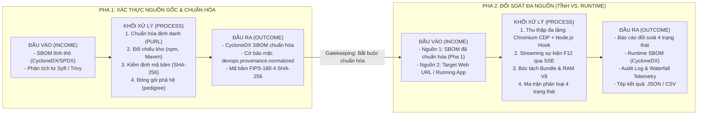

# TÀI LIỆU POC: XÁC THỰC NGUỒN GỐC VÀ ĐỐI SOÁT SBOM ĐA NGUỒN (TĨNH VS. RUNTIME)

> **Dự án**: Nền tảng phân tích rủi ro và quản lý SBOM theo quy trình DevOps<br/>
> **Sinh viên thực hiện**: Nguyễn Nhật Minh (MSSV: 20235781)<br/>
> **Giảng viên hướng dẫn**: TS. Vũ Thị Hương Giang<br/>
> **Đơn vị đào tạo**: Trường Công nghệ Thông tin & Truyền thông - Đại học Bách khoa Hà Nội

---

## 1. Bối Cảnh Và Mục Tiêu Của POC

Trong dây chuyền phát triển và tích hợp liên tục (CI/CD / DevSecOps), danh mục thành phần phần mềm (Software Bill of Materials - SBOM) đóng vai trò then chốt để quản trị rủi ro chuỗi cung ứng. Tuy nhiên, các giải pháp sinh SBOM truyền thống đang tồn tại 2 khoảng trống kỹ thuật lớn:
1. **Thiếu thông tin nguồn gốc và tính toàn vẹn (Static Provenance Gap)**: Các file SBOM trích xuất từ file manifest (`package.json`, `pom.xml`) thường thiếu thông tin phả hệ nguồn gốc (`pedigree`), mã băm toàn vẹn và thông tin kho lưu trữ, dẫn tới nguy cơ bị tấn công hoán đổi tên gói (typosquatting), tấn công hoán đổi nguồn phụ thuộc (dependency confusion) hoặc giả mạo phiên bản.
2. **Điểm mù giữa khai báo tĩnh và vận hành thực tế (Runtime Blind Spot)**: SBOM tĩnh chứa hàng trăm thư viện dư thừa hoặc chỉ dùng khi build/test (`devDependencies`), tạo ra lượng cảnh báo lỗ hổng giả (false positives) khổng lồ. Ngược lại, các thành phần nạp động qua mạng (CDN, micro-frontends, second-order dependencies) hoặc nạp ngầm trong bộ nhớ lại hoàn toàn nằm ngoài tầm kiểm soát của SBOM tĩnh.

**Mục tiêu của POC**:
Xây dựng một hệ thống hoàn chỉnh gồm 2 pha khép kín:
* **Pha 1 (Static Provenance & Normalization)**: Xác thực nguồn gốc, chuẩn hóa định danh và kiểm định mã băm toàn vẹn cho SBOM tĩnh, bổ sung trường phả hệ `pedigree` theo chuẩn quốc tế CycloneDX.
* **Pha 2 (Multi-source Static vs. Runtime Reconciliation)**: Thu thập bằng chứng thực thi runtime đa tầng (Chromium DevTools Protocol trên client + Node.js Engine Hook trên server) và đối soát tự động với SBOM tĩnh đã chuẩn hóa qua ma trận 4 trạng thái (`MATCHED`, `STATIC ONLY`, `RUNTIME ONLY`, `UNRESOLVED`).

---

## 2. Luồng Hoạt Động Tổng Thể (2 Pha)



---

## 3. Đặc Tả Chi Tiết Pha 1: Xác Thực Nguồn Gốc Và Chuẩn Hóa SBOM Tĩnh

### 3.1. Bài toán kỹ thuật
Đảm bảo tính xác thực và nguồn gốc minh bạch của các thành phần khai báo trong file manifest, phát hiện sớm các cuộc tấn công chuỗi cung ứng (Dependency Confusion, Typosquatting), các gói phụ thuộc bị chỉnh sửa trái phép (tampering) hoặc giả mạo phiên bản trước khi đưa vào dây chuyền CI/CD.

### 3.2. Bảng đặc tả Đầu vào (Income) và Đầu ra (Outcome)

| Hạng mục | Đầu vào (Income) | Khối Xử lý (Process) | Đầu ra (Outcome) |
|---|---|---|---|
| **Dữ liệu & Định dạng** | • Tệp SBOM tĩnh thô định dạng JSON (CycloneDX phiên bản 1.4 - 1.6 hoặc SPDX 2.3)<br/>• Nguồn sinh: `syft dir:. -o cyclonedx-json` hoặc `trivy fs --format cyclonedx` | 1. **Kiểm soát trùng lặp (Gatekeeping)**: Kiểm tra cờ `devops.provenance.normalized` và tỷ lệ `pedigree` (>70%) để từ chối nạp đè.<br/>2. **Chuẩn hóa PURL**: Chuẩn hóa cú pháp `pkg:npm/...`, `pkg:maven/...` theo RFC Package URL.<br/>3. **Tra cứu kho lưu trữ chính thức**: Truy vấn bất đồng bộ (ThreadPool) đến npm Registry API (`registry.npmjs.org`) và Maven Central Solr API (`search.maven.org`).<br/>4. **Kiểm tra tính toàn vẹn (Integrity Hash)**: Lấy mã hash chính thức (`integrity`: SHA-512/SHA-256) và tính mã băm SHA-256 của toàn bộ file.<br/>5. **Truy xuất thông tin mã nguồn**: Trích xuất GitHub repository URL, release tag và commit SHA (`gitHead`).<br/>6. **Đóng gói phả hệ CycloneDX**: Bổ sung đối tượng `pedigree` chứa `commits`, `ancestors`, `hashes`, `notes`. | • **Tệp SBOM CycloneDX chuẩn hóa**: Bổ sung đầy đủ phả hệ `pedigree` cho 100% component hợp lệ.<br/>• **Cờ bảo mật**: Thuộc tính metadata `devops.provenance.normalized = true`.<br/>• **Mã băm toàn vẹn**: Ghi nhận `devops.provenance.file_sha256` theo chuẩn FIPS-180-4.<br/>• **Báo cáo định lượng**: Phân loại số lượng thành phần: `VERIFIED`, `SUSPICIOUS_VERSION`, `NOT_FOUND`.<br/>• **Tệp tải về**: File JSON hoàn chỉnh phục vụ lưu trữ kiểm toán hoặc chuyển tiếp cho Pha 2. |

### 3.3. Cấu trúc trường `pedigree` CycloneDX được chuẩn hóa
```json
{
  "name": "express",
  "version": "4.18.2",
  "purl": "pkg:npm/express@4.18.2",
  "hashes": [
    {
      "alg": "SHA-512",
      "content": "sha512-5/m4Fxe44322c3f..."
    }
  ],
  "pedigree": {
    "commits": [
      {
        "uid": "250fb861a83469dc95230ad476907524e6cb32bd",
        "message": "Release v4.18.2",
        "author": { "name": "expressjs" }
      }
    ],
    "ancestors": [
      {
        "name": "express",
        "version": "4.18.2",
        "purl": "pkg:npm/express@4.18.2"
      }
    ],
    "notes": "Xác thực thành công trên kho lưu trữ chính thức: https://registry.npmjs.org"
  }
}
```

---

## 4. Đặc Tả Chi Tiết Pha 2: Thu Thập Đa Tầng Và Đối Soát Đa Nguồn

### 4.1. Bài toán kỹ thuật
Giải quyết triệt để "điểm mù runtime", phân tách giữa mã tĩnh không hoạt động và mã thực sự nạp vào bộ nhớ khi ứng dụng vận hành; phát hiện các thư viện nạp ngầm nguy hiểm hoặc sai lệch phiên bản giữa khai báo và thực thi.

### 4.2. Bảng đặc tả Đầu vào (Income) và Đầu ra (Outcome)

| Hạng mục | Đầu vào (Income) | Khối Xử lý (Process) | Đầu ra (Outcome) |
|---|---|---|---|
| **Dữ liệu & Định dạng** | • **Nguồn 1 (Static Source)**: Tệp SBOM đã qua chuẩn hóa ở Pha 1 (bắt buộc có cờ `devops.provenance.normalized = true` - cơ chế Gatekeeping tự động từ chối nếu chưa chuẩn hóa).<br/>• **Nguồn 2 (Runtime Target)**: Địa chỉ URL của ứng dụng web đang chạy (ví dụ `http://localhost:5173`) hoặc ứng dụng Node.js/Java có nhúng instrumentation agent. | 1. **Thu thập dữ liệu đa tầng**: Khởi chạy Chromium không đầu qua CDP (`Network.requestWillBeSent`, `Network.responseReceived`, `Performance`) kết hợp Node.js Agent hook vào `Module._load` để bắt trực tiếp các module được nạp vào V8 heap.<br/>2. **Truyền dẫn sự kiện thời gian thực (SSE)**: Đẩy luồng telemetry (mỗi HTTP request, script URL, kích thước, thời gian nạp) về giao diện F12 Inspector theo thời gian thực.<br/>3. **Bóc tách Bundle & Phân giải bộ nhớ**: Giải mã các file bundle đóng gói (ví dụ `index-*.js`) để nhận diện chính xác các package nằm sâu trong bộ nhớ runtime.<br/>4. **Thuật toán đối soát 4 trạng thái**: So sánh cặp tên gói và phiên bản giữa SBOM tĩnh và dữ liệu thu thập runtime. | • **Bảng ma trận đối soát 4 trạng thái**: Phân loại chi tiết từng thành phần: `MATCHED`, `STATIC ONLY`, `RUNTIME ONLY`, `UNRESOLVED`.<br/>• **Tệp Runtime SBOM (CycloneDX)**: Danh mục thực tế các package đang chạy trong bộ nhớ.<br/>• **Luồng giám sát F12 Inspector**: Biểu đồ thác nước (Waterfall), thời gian nạp, kích thước tài nguyên và danh sách module V8.<br/>• **Bộ tệp bàn giao kiểm toán**: `runtime-sbom-log-*.json`, `matching-results.json` và `matching-results.csv`. |

### 4.3. Định nghĩa ma trận 4 trạng thái đối soát
* **`MATCHED`**: Thành phần có khai báo trong SBOM tĩnh và đồng thời có bằng chứng xác thực đang hoạt động trong phiên runtime (đúng tên gói và tương thích phiên bản).
* **`STATIC ONLY`**: Thành phần có trong SBOM tĩnh nhưng hoàn toàn không được kích hoạt hay nạp vào bộ nhớ trong quá trình quan sát (thư viện dev, mã dư thừa, dead code).
* **`RUNTIME ONLY`**: Thành phần đang chạy và nạp vào bộ nhớ trong runtime nhưng hoàn toàn vắng mặt trong file manifest tĩnh (gói nạp động qua CDN, phụ thuộc cấp hai nạp ngầm, nguy cơ mã độc injection).
* **`UNRESOLVED`**: Thành phần có tín hiệu hoạt động nhưng xảy ra xung đột sai lệch phiên bản giữa khai báo tĩnh và thực tế nạp vào bộ nhớ.

---

## 5. Kết Quả Thử Nghiệm Thực Tế Trên 3 Dự Án Benchmark

POC đã được triển khai và kiểm nghiệm thực tế trên 3 dự án web có quy mô và kiến trúc đa dạng:
1. **KickZone** (Website thương mại điện tử phụ kiện thể thao - ReactJS + Vite + Node.js Express).
2. **Taxi-Booking-Web-App** (Ứng dụng đặt xe trực tuyến - Single Page Application ReactJS).
3. **IoT ThingsBoard Community** (Hệ thống giám sát vạn vật kết nối cấp công nghiệp - Microservices Angular/React + Java Spring Boot).

### 5.1. Bảng số liệu đối soát thực nghiệm

| STT | Dự án thử nghiệm | SBOM Tĩnh (Components) | Bằng chứng Runtime (Observables) | MATCHED (Trùng khớp) | STATIC ONLY (Chỉ có ở tĩnh) | RUNTIME ONLY (Nạp ngầm) | UNRESOLVED (Lệch phiên bản) | Tỷ lệ STATIC ONLY (%) |
|:---:|:---|:---:|:---:|:---:|:---:|:---:|:---:|:---:|
| **1** | **KickZone** | 871 | 28 | 29 | 823 | 1 | 19 | **94.5%** |
| **2** | **Taxi-Booking-Web-App** | 355 | 26 | 16 | 336 | 10 | 3 | **94.6%** |
| **3** | **IoT ThingsBoard** | 2,281 | 25 | 42 | 2,229 | 4 | 10 | **97.7%** |

### 5.2. Nhận xét & Đánh giá kết quả thực nghiệm
1. **Thu hẹp bề mặt tấn công thực tế (Attack Surface Reduction)**:
   * Trên **94% - 97.7%** các thành phần rơi vào nhóm `STATIC ONLY`. Điều này chứng minh rằng phần lớn các lỗ hổng CVE cảnh báo từ file manifest tĩnh thuộc về các thư viện build/test dư thừa không hề chạy khi ứng dụng vận hành. Nhờ đó, đội ngũ bảo mật có thể lọc bỏ đến 95% cảnh báo giả (false positives), tập trung nguồn lực xử lý các thư viện thực sự nằm trên đường dẫn thực thi.
2. **Xóa bỏ điểm mù vận hành (Runtime Blind Spot Elimination)**:
   * Hệ thống đã phát hiện từ **1 đến 10 thành phần nạp ngầm** (`RUNTIME ONLY`) ở mỗi dự án. Đây là các tài nguyên nạp qua CDN bên ngoài hoặc thư viện phụ thuộc gián tiếp cấp 2 hoàn toàn không hề có trong file manifest tĩnh. Nếu không có cơ chế thu thập runtime, đây chính là các "cửa sau" bảo mật hoàn toàn vô hình trước công cụ quét tĩnh.
3. **Kiểm soát rủi ro sai lệch phiên bản**:
   * Nhận diện chính xác từ **3 đến 19 trường hợp `UNRESOLVED`** do phiên bản nạp trong bộ nhớ khác biệt so với phiên bản khai báo ban đầu trong file lock/manifest (do cơ chế bundle hoisting hoặc dynamic loading).

---

## 6. Hướng Dẫn Vận Hành Và Tái Lập Thử Nghiệm

### 6.1. Khởi động môi trường
Hệ thống được thiết kế khởi động đơn giản qua kịch bản tự động hoặc lệnh độc lập:

```powershell
# 1. Khởi động Backend Spring Boot (Port 8080)
$env:JAVA_HOME = "C:\Users\DGC\.jdks\jdk-21"
$env:Path = "$env:JAVA_HOME\bin;$env:Path"
cd demo
.\mvnw.cmd spring-boot:run

# 2. Khởi động Frontend React (Port 5173)
cd sbom-frontend
npm run dev
```

### 6.2. Kịch bản chạy Demo 2 Pha
1. **Bước 1 (Truy cập Pha 1)**: Mở trình duyệt tại `http://localhost:5173/provenance`.
2. **Bước 2 (Nạp & Chuẩn hóa)**: Nạp tệp SBOM thô (`cyclonedx-kickzone.json`). Nhấn **"Bắt đầu chuẩn hóa và xác thực"**. Hệ thống sẽ kiểm tra mã băm SHA-256, tra cứu npm Registry, điền trường `pedigree` và xuất file SBOM đã chuẩn hóa.
3. **Bước 3 (Chuyển sang Pha 2)**: Mở `http://localhost:5173/reconciliation`.
4. **Bước 4 (Đối soát Runtime)**:
   * Tại **Source 1**: Nạp tệp SBOM đã được chuẩn hóa từ Pha 1 (hệ thống sẽ từ chối nếu nạp file thô chưa có cờ `devops.provenance.normalized`).
   * Tại **Source 2**: Nhập URL mục tiêu (ví dụ `http://localhost:5173`).
   * Nhấn **"Bắt đầu thu thập & Đối soát"**.
5. **Bước 5 (Quan sát kết quả)**: Theo dõi luồng F12 Inspector trực tiếp qua SSE và xem bảng phân loại chi tiết 4 trạng thái, sau đó xuất báo cáo định dạng JSON hoặc CSV.

